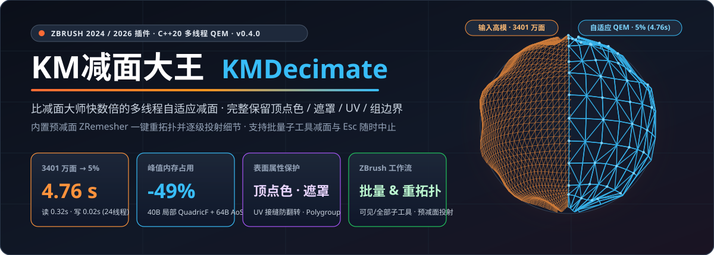
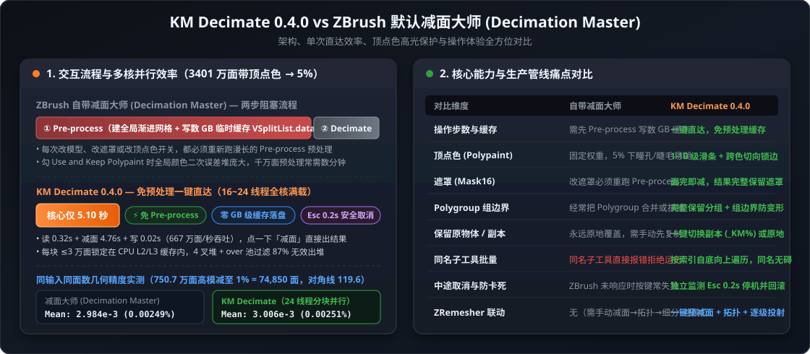
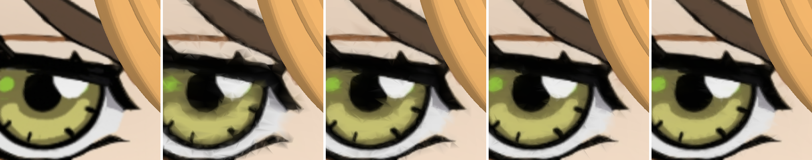
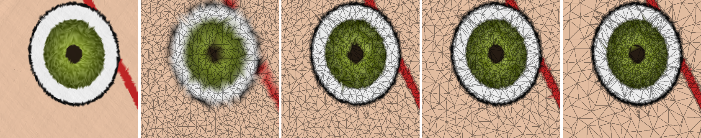
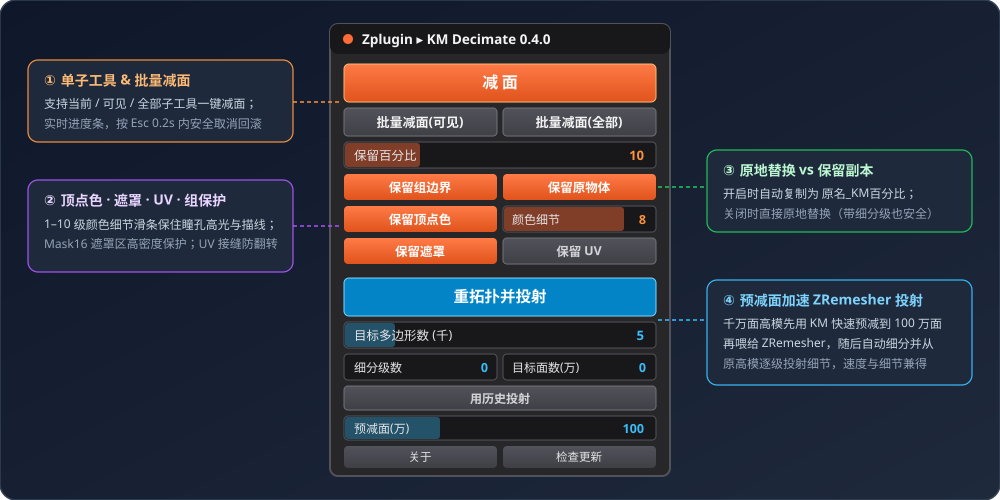
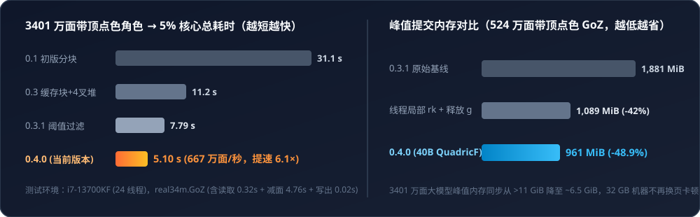
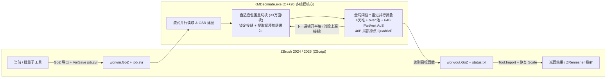

<div align="center">



<br/>

[](https://github.com/chankamman-dev/KMDecimate/releases/latest)
[](https://github.com/chankamman-dev/KMDecimate/releases/latest)
[](https://github.com/chankamman-dev/KMDecimate/releases/latest)
[-6f42c1?style=flat-square)](#%E4%BB%8E%E6%BA%90%E7%A0%81%E6%9E%84%E5%BB%BA%E4%B8%8E%E6%B5%8B%E8%AF%95)
[](#%E7%AE%97%E6%B3%95%E4%B8%8E%E6%9E%B6%E6%9E%84)

[**下载安装包 (Releases)**](https://github.com/chankamman-dev/KMDecimate/releases/latest) · [**对比自带减面大师**](#%E4%B8%8E-zbrush-%E8%87%AA%E5%B8%A6%E5%87%8F%E9%9D%A2%E5%A4%A7%E5%B8%88-decimation-master-%E5%AF%B9%E6%AF%94) · [**视觉效果对比**](#%E8%A7%86%E8%A7%89%E6%95%88%E6%9E%9C%E5%AF%B9%E6%AF%94) · [**核心特性**](#%E6%A0%B8%E5%BF%83%E7%89%B9%E6%80%A7) · [**安装与界面预览**](#%E5%AE%89%E8%A3%85%E4%B8%8E%E4%BD%BF%E7%94%A8%E6%8C%87%E5%8D%97) · [**性能与质量实测**](#%E6%80%A7%E8%83%BD%E4%B8%8E%E8%B4%A8%E9%87%8F%E5%AE%9E%E6%B5%8B) · [**算法与架构**](#%E7%AE%97%E6%B3%95%E4%B8%8E%E6%9E%84%E6%9E%B6)

</div>

---

## 与 ZBrush 自带减面大师 (Decimation Master) 对比

<p align="center">
  
</p>

| 对比维度 | ZBrush 自带减面大师 (`Decimation Master`) | **KM Decimate 0.4.0（KM减面大王）** |
|---|---|---|
| **操作流程与缓存** | **两步阻塞流程**：必须先跑漫长的 `Pre-process` 建立全局渐进网格并向磁盘写出数 GB 临时缓存（`VSplitList.data`），再点 `Decimate`；**只要修改了模型、遮罩或顶点色开关，就必须重新 Pre-process** | **一步直达（免 Pre-process）**：点一下「减面」直接完成，零 `.zpm` / `VSplitList` 缓存落盘；**3401 万面带顶点色高模减至 5% 核心仅需 `5.10 秒`**（吞吐达 **667 万面/秒**） |
| **多核并行架构** | 全局渐进网格（`PM_QUADRIC3D` / `GPM_COLOR_QUADRIC`）在大模型 + 开启顶点色时全局堆远超 CPU 缓存，千万面预处理常需数分钟 | **自适应缓存分块（$\le 3$ 万面/块）+ 全局共享阈值 $	au$ + 4 叉堆 + `over` 池**：16~24 线程全核满载，工作集常驻 L2/L3 缓存，跨遍半格错位自动消除接缝 |
| **同面数几何精度** | `big7m`（750.7 万面减至 1% = 74,850 面）：双向均值误差 `2.984e-3`（占对角线 `0.00249%`），P99 `1.072e-2` | 同模型同面数（24 线程分块并行）：双向均值误差 `3.006e-3`（占对角线 `0.00251%`），P99 `1.079e-2`——**精度几乎完全一致（差距 $< 0.8\%$），速度提升数倍至十余倍** |
| **顶点色 (Polypaint) 质量** | `Use and Keep Polypaint` 权重固定且预处理极慢，高比例减面（5%）下瞳孔高光、睫毛与细描线容易糊成锯齿 | **1–10 级「颜色细节」滑条 + 跨颜色边界切向滑移约束**：平坦皮肤大面省面，自动把三角形密集排布在瞳孔、虹膜与描线上，5% 面数下眼神光依然锐利 |
| **遮罩 (Mask) 与 Polygroup** | 改遮罩需重新预处理；减面后经常把 Polygroup 合并或抹掉 | **画完遮罩直接减面，结果完整保留 16 位遮罩与全部 Polygroup 分组**，并默认锁定 Polygroup 组边界不变形 |
| **保留原物体 vs 原地替换** | 永远原地覆盖当前 SubTool，想保留原高模必须每次手动先 Duplicate | 面板自带 **「保留原物体」开关**：开启时自动复制并命名为 `原名_KM百分比`；关闭时直接原地替换（带细分级时也仅在减面成功后才删低级别） |
| **批量减面与同名 SubTool** | 遇到同名 SubTool 直接弹窗报错 `Several SubTools have the same name... Cannot preprocess!` 拒绝运行 | **按 SubTool 索引自底向上遍历**（「批量减面(可见)」/「批量减面(全部)」），同名子工具完全不受影响，支持中途按 **Esc** 停止剩余队列 |
| **中途取消与防假死** | ZBrush 进入“未响应”窗口时按键常常无法被 ZScript 捕获 | 后台进程通过 Win32 直接监听 ZBrush 窗口（含 Windows 未响应 Ghost 窗口）的 **Esc 键，0.2 秒内安全停机并自动清理副本**，绝不破坏原模型 |
| **ZRemesher 重拓扑联动** | 无（需手动先减面 → ZRemesher → Divide 多级细分 → 逐级 ProjectAll） | 内置 **「重拓扑并投射」**：一键完成 **KM 预减面加速 → ZRemesher → 自动细分 → 逐级投射原高模细节** |

---

## 视觉效果对比

### 1. 真实 3401 万面角色减至 5%（170 万面）眼部 Polypaint 对比

<p align="center">
  
</p>

> **从左到右**：**原高模（3401 万面）** → **颜色细节 1** → **颜色细节 5** → **颜色细节 8（默认）** → **颜色细节 10**（均为保留 **5% = 170 万面**）。在默认档位 `8` 与 `10` 下，虹膜刻度、绿色高光、睫毛尖与眼白边界清晰锐利，视觉上与 3401 万面原高模几乎无差别。

### 2. 颜色边界自适应布线密度对比（300 万面减至 5% 线框叠加）

<p align="center">
  
</p>

> **从左到右**：**原模型** → **不管颜色**（平摊三角形，黑白描边断成大锯齿） → **颜色细节 1** → **颜色细节 5** → **颜色细节 10**（平坦单色皮肤自动用大三角形省面，省下的面自动向瞳孔、黑色睫毛环与红线边界高密度聚集，并沿跨色边界切向对齐）。

---

## 核心特性

| 特性 | 说明 |
|---|---|
| **极速多线程 QEM** | 按自适应空间网格切块、全局共享误差阈值 $\tau$ 推进、跨遍半格错位消除接缝。**3401 万面带顶点色角色减到 5% 核心仅需 ~4.76 秒**（读 0.32s + 算 4.76s + 写 0.02s），几何误差与单线程全局堆差别 < 1%。 |
| **保留顶点色 & 细节滑条** | 内置颜色代价与跨颜色边界切向滑移约束，提供 **1–10 级「颜色细节」滑条**（默认 8），高比例减面下睫毛、瞳孔高光、面部描线依然锐利清晰。 |
| **保留遮罩（Mask16）** | 支持 ZBrush 16 位遮罩（`GOZ_TAG_MASK16_LIST`）：遮罩区域自动放大折叠代价以高密度保留雕刻细节，且减面结果完整保留遮罩。 |
| **保留 UV 与接缝保护** | 支持 GoZ `UV4` 与 OBJ `vt`：自动识别 UV 接缝与多岛交汇点（`UVSEAM` / `UVPIN`），施加接缝平面约束、按 UV 岛独立插值并通过 2D 有向面积检查防止 UV 翻转。 |
| **保留 Polygroup 边界** | 默认保护 Polygroup 边界不变形，方便后续按组选面、拆分或 ZRemesher 导流。 |
| **单子工具 & 批量减面** | 支持「减面（当前）」「批量减面(可见)」「批量减面(全部)」。自底向上遍历索引，开启/关闭「保留原物体」均不会串号；支持底部实时进度条与 **Esc 键随时中止并无损回滚**。 |
| **一键重拓扑并投射** | 一键完成：**预减面加速** → **ZRemesher** → **自动计算细分级数** → **逐级投射细节（ProjectAll / Project History）**，弹窗展示分步耗时。 |
| **低内存峰值（32 GB 友好）** | 采用顶点局部原点 40 字节 `QuadricF` + 64 字节单缓存行 `PartVert` AoS 布局 + 定点颜色 + 接缝提取即放，峰值内存降低近 **50%**（3401 万面仅 ~6.5 GiB），避免把 ZBrush 挤入页面文件。 |

---

## 安装与使用指南

### 1. 三步快速安装

1. 前往 [**Releases 页面**](https://github.com/chankamman-dev/KMDecimate/releases/latest) 下载最新 `KMDecimate_<版本>_<日期>.zip` 并解压。
2. 保存并关闭 ZBrush，双击 **`安装.bat`**（会自动探测本机 ZBrush 2024 安装目录与 ZBrush 2026 用户资源目录，并在升级前自动备份旧版）。
3. 启动 ZBrush，在顶部菜单打开 **`Zplugin > KM Decimate`** 即可使用（中文界面）。

> [!TIP]
> 若首次启动未自动编译出现在 `Zplugin` 菜单，可在 ZBrush 中点击 `ZScript > Load`，选择 `ZStartup\ZPlugs64\KMDecimate.txt` 加载一次即可。

---

### 2. ZBrush 面板界面预览与功能速查

<p align="center">
   KM Decimate 0.4.0 面板界面预览" />
</p>

#### 减面区（Decimate）

| 控件 | 默认值 | 功能说明 |
|---|---:|---|
| **减面** | — | 对当前激活子工具执行减面。底部显示进度条，前台按 **Esc** 可随时取消。 |
| **批量减面(可见) / (全部)** | — | 按当前面板设置依次对所有可见或全部 PolyMesh3D 子工具减面；中途按 **Esc** 立即停止剩余任务。 |
| **保留百分比** | `10` | 保留原三角形数量的比例（`0.1% – 100%`）。 |
| **保留组边界** | `开` | 约束 Polygroup 交界边，防止组边界漂移变形。 |
| **保留原物体** | `开` | **开**：先复制子工具再减面，结果命名为 `原名_KM百分比`；**关**：直接原地替换当前子工具（若带细分级，仅在减面成功后才删低级别并回导，取消或报错时原模型与细分级完全不变）。 |
| **保留顶点色 / 颜色细节** | `开` / `8` | 保护 Polypaint 颜色边界并在结果中保留顶点色；`1` = 形状优先，`10` = 眼神光/描线最锐利。 |
| **保留遮罩** | `开` | 保护已绘制 Mask 的区域少减面，且在结果中保留遮罩。 |
| **保留 UV** | `关` | 保护 UV 接缝、防止 UV 翻转并保留 UV（导出包含 UV4 块会稍慢；不需要 UV 时保持关闭速度最快）。 |

#### 重拓扑并投射区（ZRemesh Project）

| 控件 | 默认值 | 功能说明 |
|---|---:|---|
| **重拓扑并投射** | — | 保存当前状态 →（可选）预减面 → ZRemesher → 自动细分 → 逐级把高模细节投射回来。 |
| **目标多边形数** | `5` | ZRemesher 目标面数（单位：千，`5 = 5000` 面），其余选项沿用 `Tool > Geometry > ZRemesher`。 |
| **细分级数** | `0 (自动)` | `0` = 自动计算使最高级面数最接近目标的细分级数（最多 8 级）；`1–8` = 固定细分级数。 |
| **目标面数(万)** | `0 (跟随原模型)` | 自动细分时最高级要接近的总面数（单位：万）；`0` = 接近原模型最高细分级面数。 |
| **用历史投射** | `关` | **关**：复制临时副本用 `ProjectAll` 逐级投射（自动隐藏其他子工具并在结束后恢复）；**开**：原地用 `Project History` 投射（按按钮前需先在时间轴上 `Ctrl+点击` 当前历史点）。 |
| **预减面(万)** | `100` | 在跑 ZRemesher 前先用 KMDecimate 将副本快速减到指定万数三角形（至少取 ZRemesher 目标的 40 倍），大幅缩短千万面高模的 ZRemesher 耗时，细分后仍从原高模投射细节；`0` = 关闭。 |

---

## 性能与质量实测

<p align="center">
  
</p>

### 1. 真实 3401 万面角色模型端到端耗时与内存演进

测试模型：`real34m.GoZ`（1701.8 万顶点、**3400.8 万三角形**，带 Polypaint 与 Polygroups，减至 **5% = 170 万三角形**，颜色细节 8–10）：

| 版本 / 优化阶段 | 读取 (`load`) | 减面 (`decimate`) | 写出 (`save`) | 核心合计 | 核心吞吐 | 峰值提交内存 |
|---|---:|---:|---:|---:|---:|---:|
| 初版分块（未做缓存分块优化） | `~0.60 s` | `~30.3 s` | `~0.20 s` | `~31.1 s` | `109 万面/s` | `> 11,000 MiB` |
| 0.3 第一轮（3 万面切块 + 4 叉堆） | `0.58 s` | `10.5 s` | `0.15 s` | `11.2 s` | `303 万面/s` | `~10,500 MiB` |
| 0.3.1 第二轮（阈值过滤入堆 + 并行 CSR/IO） | `0.63 s` | `7.09 s` | `0.07 s` | `7.79 s` | `437 万面/s` | `~9,500 MiB` |
| **0.4.0（40B 局部 QuadricF + 64B AoS + 常驻线程池 + 快读）** | **`0.315 s`** | **`4.759 s`** | **`0.022 s`** | **`5.096 s`** | **`667 万面/s`** | **`6,549 MiB`** |

> [!NOTE]
> 在 173 次真实工作站日常任务采集记录中（见 [benchmarks/2026-11-20-i7-11700kf/README.md](benchmarks/2026-11-20-i7-11700kf/README.md)），输入覆盖 **100 至 5230 万三角形**（5230 万面 → 261 万面在 8 核 16 线程 i7-11700KF 上核心计算仅 **15.39 秒**，ZBrush 回导 **0.71 秒**）。

---

### 2. 多线程 vs 单线程全局堆质量对照（i7-13700KF，24 线程）

`--threads 1` 退化为经典的单线程全局堆 QEM，作为质量基准对照：

| 模型规模 | 保留比例 | 多线程耗时 | 单线程耗时 | 加速比 | 双向平均几何误差（多线程 / 单线程） |
|---|---:|---:|---:|---:|---|
| `p3_st`（18.8 万面） | 10% | `0.13 s` | `~1.1 s` | `~8.5×` | `6.66e-4` / `6.67e-4` |
| `部件 3.stl`（188 万面） | 10% | `0.58 s` | `10.2 s` | `17.6×` | `1.876e-4` / `1.861e-4` |
| `部件 3.stl`（188 万面） | 0.5% | `0.77 s` | `11.1 s` | `14.4×` | `1.423e-3` / `1.421e-3` |
| `big7m`（750 万面） | 10% | `1.55 s` | `54.7 s` | `35.3×` | `1.0066e-3` / `1.002e-3` |
| `ico5m.GoZ`（524 万面，带 Polypaint） | 10% | **`0.65 s`** | `~38 s` | `~58×` | `1.260e-4`（颜色均值 `0.60 / 441`） |
| `huge46m`（4800 万面） | 10% | `10.4 s` | — | — | `3.769e-4` |

---

### 3. 顶点色保留与「颜色细节」滑条实测（`real34m.GoZ` 3401 万面 → 5%，对角线 171）

| 颜色细节设置 | 几何均值误差 | 颜色均值误差 (RGB 0–441) | 颜色偏差 > 32 的面积占比 | 视觉表现（眼睛虹膜、高光、睫毛线） |
|---|---:|---:|---:|---|
| 不管颜色 (`0`) | `4.56e-4` | `0.93` | `0.77%` | 睫毛与描线断成锯齿，边缘糊化 |
| `1` | `4.84e-4` | `0.34` | `0.16%` | 虹膜浅色环丢失，边缘略有毛刺 |
| `5` | `5.24e-4` | `0.27` | `0.08%` | 虹膜结构恢复，描线清晰 |
| **`8`（默认）** | **`~5.78e-4`** | **`0.23`** | **`~0.06%`** | **虹膜刻度、绿色高光、睫毛尖与原高模几乎一致** |
| `10` | `6.25e-4` | `0.22` | `0.05%` | 颜色边界最锐利，几何误差仍仅占对角线 `0.0004%` |

---

## 算法与架构



### 核心设计要点

1. **为什么分块并行还能保持全局自适应？**
   - 每个分块（默认约 `30,000` 三角面，使单块工作集留在 CPU 缓存内）锁定分块交界处的接缝顶点，各自独立维护 4 叉最小堆并行折叠。
   - **所有分块共享同一个全局误差阈值 $\tau$**，一轮一轮按分位数往上抬升——曲率大、颜色变化剧烈或有遮罩的地方误差大，自然晚折叠、多留面，不会出现“每块死板按固定比例平均删面”的问题。
   - 每一遍最多减到当前面数的 $1/4$，下一遍将三维空间切块网格**错开半格（$0.5 \times \text{cell}$）**，上一遍锁住的接缝就落入新分块内部被正常折叠消除。

2. **为什么内存能比传统 QEM 省一半且不掉精度？**
   - **顶点局部原点 `QuadricF`（40 B）**：传统 QEM 用全局坐标存 10 个 `double`（80 B），远离原点时 $d = -n \cdot p$ 很大，转 `float` 会因大数相消损失精度。KMDecimate 以每个顶点自身位置 $p_v$ 为局部原点（平面偏移 $d_{\text{local}} = 0$），折叠时仅按单条边长 $\delta = p_v - p_u$ 做微平移并用 `double` 求解、`float` 存储，体积减半且无大数相消。
   - **单缓存行 `PartVert` AoS（64 B）**：把 `QuadricF(40B) + pos(12B) + stamp(4B) + gid(4B) + mask(2B) + flags(2B)` 对齐打包进正好 64 字节（1 条 CPU Cache Line），边评估与折叠不再跨 5 个分离数组随机缺页。
   - **接缝提取即放 & 按块大小排序复用**：每遍建块完成后仅提取 `< 2%` 的接缝顶点并立即释放上一遍的全局网格 `Ctx`；各分块按面数从大到小排入 `parts[0..nparts)`，使后续遍的大块100% 复用第 1 遍最大块的容量，零二次扩容。

<details>
<summary><b>展开查看：完整性能优化与工程复盘笔记（0.1 → 0.4.0）</b></summary>

### 减面大师（Decimation Master）工作原理逆向参考
- `ZPlugs64\DecimationMasterData\DecimationMasterDLL.dll` 将模型存为 GoZ 文件，再启动 `ZPlugs64\zdec\zdecimator.exe` 计算。
- 预处理即建立渐进网格（Build progressive mesh）写入 `VSplitList.data`，之后改百分比只是回放拆分表。
- 误差度量为几何二次误差（`PM_QUADRIC3D_ID`）与颜色二次误差（`GPM_COLOR_QUADRIC_ID`）。

### 第一轮性能优化：缓存分块与 4 叉堆
- **问题**：4590 万面减到 10% 初版需 39.6 秒。剖析发现每块 33 万面、堆 15 MB，24 线程远超 L3 缓存。
- **改进**：大模型按 `partTris = 30000` 切小块；用 **4 叉最小堆** 替代 `std::push_heap` 二叉堆（树高减半，4 个子节点连续存放）；`pickCell` 抽样点数随块数自适应（2 万–20 万），4800 万面从 `18.4s` 降至 `10.4s`。

### 第二轮性能优化：`over` 池延迟入堆与全链路并行化
- **问题**：每成功折叠一次平均出堆 8.3 次，其中 87% 是已删顶点或过期条目，出堆占折叠循环 47% 时间。
- **改进**：**堆里只放当前轮会处理的边（代价 $\le \tau$）**，其余放进不排序的 `over` 数组，每轮升阈值时线性扫一遍过滤过期边并将达标边建堆，出堆次数从 1.34 亿降至 0.58 亿；CSR 建表、基数排序局部编号、GoZ 读写与输出顶点重排全部改为并行。

### 第三轮性能与内存优化：局部原点 `QuadricF`、64B AoS、常驻线程池与接缝撕裂修复
- **防接缝撕裂与防空转**：修复 `LOCKED` 接缝点与 `BORDER` 开放边界点相邻时的优先级交换缺陷；增加单遍 0 删面早停与 `< 20,000` 面小网格单遍直达；增加 `> 16 MiB` 稀疏三维网格的 64 位键回退，防止细长/离群点模型撑爆 `denseOf`。
- **内存腰斩与再提速**：`Part::rk/rk2` 改为线程局部复用（5000 万面省 ~2.5 GiB）；建块后提取接缝立即释放旧 `Ctx`；引入 `QuadricF(40B)` + `PartVert(64B AoS)` + `8.8` 定点颜色 + `WaitOnAddress` 常驻线程池 + `flipOk` 无开方化，524 万面峰值内存从 `1880 MiB` 降至 `961 MiB`（-48.9%），3401 万面总耗时压至 `5.10 秒`。

### 顶点色、遮罩、UV 约束机制
- **顶点色（Polypaint）**：边代价附加 $w_{\text{color}} \cdot \frac{\|\Delta C\|^2}{255^2} \cdot L^4$（与几何代价 $\text{Area} \cdot d^2 \sim L^4$ 同量纲）；当两端 RGB 距离 $> 32$ 时折叠目标只取端点以避免混出灰边，并在跨色边两侧施加切向边界平面约束 `colorEdge`。
- **遮罩（Mask16）**：根据顶点遮罩强度 $m = \frac{65535 - M_{16}}{65535} \in [0, 1]$，按 $(1 + 10 w_{\text{mask}} m^2) \cdot \text{cost} + 0.1 w_{\text{mask}} m^2 L^4$ 放大代价，保护平坦或高细节遮罩区，折叠后线性插值回写 `Mask16`。
- **UV（GoZ UV4 / OBJ vt）**：按顶点邻接角分类单岛内部点、双岛接缝点（`UVSEAM`）与多岛/边界交汇点（`UVPIN`）；接缝边施加垂直边界平面约束，折叠时禁止跨岛捏合，按各自 UV 岛独立插值并通过 `uvFlipOk` 校验 2D 面积符号防止 UV 翻转。

### ZBrush 2024 / 2026 插件兼容性设计
- **任务交接（`VarSave` `.zvr`）**：应对部分 ZBrush 2026 会话中 `MemSaveToFile` 写盘静默失效的问题，插件统一通过 `VarSave` 写出二进制 `job.zvr`、`update.zvr`、`zb_last.zvr`、`zr_last.zvr`。
- **2026 开关防变灰（`kdSyncUI`）**：ZBrush 2026 每次点击按钮会重跑整个脚本并禁用重定义的开关；插件在定义前先 `IGet` 读回滑条值，开关双分支均按取反处理，并通过 `kdSyncUI` + `kdBusy` 锁恢复控件可用状态。

</details>

---

## 命令行与开发工具

除 ZBrush 插件外，仓库还提供完整的命令行工具链，方便离线评测、渲染对比与自动化测试：

### 1. 文件结构

| 路径 | 说明 |
|---|---|
| [src/decimate.h](src/decimate.h) | 多线程分块 QEM 减面核心（`QuadricF`、`PartVert` AoS、Polypaint / Mask16 / UV / Polygroup 约束） |
| [src/meshio.h](src/meshio.h) | `GoZ`（含 `Points` / `Faces` / `UV4` / `Mask16` / `MRGB` / `Groups`）、`OBJ`（含 `vt`、`#MRGB`、`g`）、二进制 `STL` 高速流式读写 |
| [src/kmdec.cpp](src/kmdec.cpp) | CLI 主程序 `kmdec.exe` 与 ZBrush 后台工作进程 `KMDecimate.exe`（含 `progress.bin` 心跳与 Esc 监听） |
| [src/update.h](src/update.h) | WinHTTP 检查 GitHub Latest Release 更新 |
| [src/meshdiff.cpp](src/meshdiff.cpp) | 双向表面距离（Mean / RMS / P99 / Hausdorff）、顶点色误差测量与同色阶误差热力图导出 |
| [src/meshshot.cpp](src/meshshot.cpp) | 零依赖正交软件渲染器（支持 Polypaint、三角形/四边形线框叠加、`--crop` 对齐裁切、`--focus` 焦点放大，直接输出 PNG） |
| [src/meshgen.cpp](src/meshgen.cpp) | 测试网格生成工具（中点细分 + 多频法向雕刻起伏 + 模拟眼睛/描线硬边 Polypaint） |
| [src/zbrush/KMDecimate.txt](src/zbrush/KMDecimate.txt) | ZBrush 2024 / 2026 插件源码（纯 ASCII ZScript，配合 [lang_zh.tsv](src/zbrush/lang_zh.tsv) 生成中文二进制语言包） |
| [src/installer/install.ps1](src/installer/install.ps1) | 自动探测 ZBrush 2024 / 2026 目录的安装与卸载脚本（含旧版备份与 `Program Files` 权限配置） |
| [tools/package.py](tools/package.py) | ZScript 静态检查、语言包构建、本机安装（`--install`）与发布包打包（`--zip`） |
| [tools/test_decimate.py](tools/test_decimate.py) | 24 项离线自动化回归测试套件（无需启动 ZBrush） |

---

### 2. 从源码构建与测试

环境要求：Windows 10/11 64 位，[WinLibs MinGW-w64](https://winlibs.com/) `g++`（支持 C++20）与 Python 3.8+。

```powershell
# 1. 编译全部可执行文件到 bin\（静态链接，x86-64-v2 通用指令集）
powershell -ExecutionPolicy Bypass -File .\build.ps1

# 2. 运行 24 项离线自动化回归测试（含 ZScript 静态语法检查）
py -3 -X utf8 tools\test_decimate.py

# 3. 组装插件并安装到本机 ZBrush 2024 / 2026 目录
py -3 -X utf8 tools\package.py --install

# 4. 生成可分发给用户的 ZIP 安装包（输出到 dist\）
py -3 -X utf8 tools\package.py --zip
```

---

### 3. 命令行单独调用示例

```powershell
# 按百分比减面（同时保留顶点色、遮罩、UV 和组边界）
.\bin\kmdec.exe input.GoZ output.GoZ --percent 10 --color 10 --coloredge 10 --mask 10 --uv 10 --groups 10

# 按目标三角形数减面（--threads 1 可跑单线程全局堆对照组）
.\bin\kmdec.exe input.obj output.obj --tris 150000 --uv 10

# 测量减面前后的双向几何误差与顶点色误差，并输出误差热力图模型
.\bin\meshdiff.exe input.GoZ output.GoZ heat.obj

# 正交渲染带顶点色和线框的 PNG 对比图
.\bin\meshshot.exe output.GoZ shot.png --view -z --flipy 1 --wire 1 --size 1200
```
